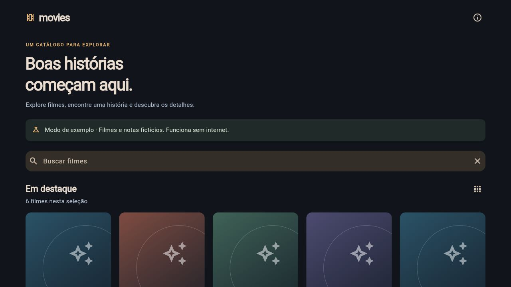

# Movies

[](https://flutter.dev)
[](pubspec.yaml)
[](LICENSE)
[](https://github.com/kleberandrade/movies-flutter/actions/workflows/flutter.yml)



A Flutter classroom movie explorer by Kleber de Oliveira Andrade. Browse a responsive catalog, search titles, load more results and open a movie's synopsis, year, score, runtime, genres and original language. The interface is in Portuguese.

The default **sample mode** uses twelve original fictional movies, ratings and local illustrations. It works without a key or TMDB requests. These are teaching fixtures, not real movies or API results.

## Requirements and setup

Tested toolchain: **Flutter 3.50.0 / Dart 3.14.5** (`.fvmrc`). Install that Flutter release; FVM is optional. Chrome is required for Web development. Android needs an SDK/JDK and accepted licenses; iOS needs macOS and Xcode. Do not accept terms on behalf of another person.

```sh
git clone https://github.com/kleberandrade/movies-flutter.git
cd movies-flutter
flutter --version
flutter pub get --enforce-lockfile
flutter run -d chrome
```

If Flutter 3.50.0 is managed with FVM, use `fvm install 3.50.0`, `fvm use 3.50.0`, and prefix Flutter/Dart commands with `fvm`. Alternatively, select a separate SDK in this project's terminal. The migration does not require replacing a global SDK used by other projects.

Try searching `farol`, open **O último farol**, return to the catalog, clear the search and use **Carregar mais filmes**. Search `xyz` to see the empty state. The grid-size control changes card density. **Sobre e créditos** explains sample data and TMDB attribution.

## Optional live TMDB mode

Obtain your own **API Read Access Token** in your TMDB account and review the [official terms and attribution requirements](https://developer.themoviedb.org/docs/faq). No credential is supplied or read from another project. The legacy token in Git history must be revoked/rotated by its owner.

Copy `config/example.json` to ignored `config/local.json`, set `DEMO_MODE` to `"false"` and enter your own token in `TMDB_TOKEN`. Then:

```sh
flutter run -d chrome --dart-define-from-file=config/local.json
# Or use --dart-define=DEMO_MODE=false --dart-define=TMDB_TOKEN=YOUR_OWN_READ_TOKEN
```

Live mode requests popular movies, title search and details in `pt-BR`. API/network errors offer retry and never silently switch to sample results. Already-loaded pages survive a pagination error. Poster failures show a labeled local illustration.

External build configuration is **not secret storage**: tokens embedded in a browser/mobile client can be extracted. Use an authenticated backend for credentials in a distributed production service. Do not commit local configuration or tokens. See [architecture and migration](docs/architecture.md) for security, state ownership and current scope.

## Tests and reproducible Web build

```sh
flutter pub get --enforce-lockfile
dart format --output=none --set-exit-if-changed lib test example
flutter analyze --no-pub
flutter test --no-pub --concurrency=1 --coverage
dart run example/parse_movie.dart
flutter build web --no-pub --release --no-web-resources-cdn
python3 -m http.server 8784 --directory build/web --bind 127.0.0.1
```

Open `http://127.0.0.1:8784`. The Web build defaults to sample mode and bundles its renderer resources. The build needs package/Flutter artifacts downloaded during setup; it is not an offline dependency installation. `pubspec.lock` is committed and CI pins Flutter 3.50.0, runs formatting/analyzer/tests and builds the same Web artifact on `main` pushes and pull requests. CI does not deploy or publish packages.

Tests use local JSON and an injected Dio adapter: parsing and malformed data, pagination/search, auth/request parameters, HTTP errors/timeouts, stale responses, duplicate IDs, retry, disposal, widget navigation, empty states and large text. They do not require or prove a live TMDB integration. Coverage output is generated locally; no coverage percentage is advertised.

Native commands: `flutter build apk --debug` and `flutter build ios --simulator --debug`. Store signing and physical-device validation are outside this classroom migration. See [verified validation results and limits](docs/validation.md).

## Current dependencies

Direct packages: Dio **5.11.1**, flutter_svg **2.4.0**, cupertino_icons **2.0.0**, material_ui **1.11.1** and flutter_lints **6.0.0**; Flutter and flutter_test come from SDK **3.50.0**. All direct packages are current. Three transitive versions remain limited by upstream constraints; see the [dependency audit](docs/dependencies.md). No dependency overrides are used.

The [Portuguese tutorial source](docs/medium-tutorial.pt-BR.html) contains current snippets and exactly five final exercises. Its complete parsing example is executable with `dart run example/parse_movie.dart`.

## Project map

- `lib/domain`: immutable movie/page values and JSON boundary validation.
- `lib/data`: TMDB transport, safe failures, repository contract and sample repository.
- `lib/state`: catalog search/pagination ownership and stale-response protection.
- `lib/ui`: catalog, details, reusable poster/error/credits components.
- `assets/fixtures`: fictional sample catalog; `test`: deterministic behavior tests.
- `android`, `ios`, `web`: Flutter platform scaffolds.

The old Dart 2 constructors and controllers have been replaced; this is an application, not a published library. Migration rationale and glossary are in [architecture](docs/architecture.md). Implementation decisions and tool limitations are in the [work log](docs/work-log.md).

## Classroom material and credits

Original tutorial: [Criando um aplicativo em Flutter para consumir uma API de Filmes (TMDb)](https://kleberandrade.medium.com/criando-um-aplicativo-em-flutter-para-consumir-uma-api-de-filmes-tmdb-2b5a9982bfcd). [Editorial revision record](docs/medium-update.pt-BR.md). [Archived 2020 notes, screenshots and exercises](docs/classroom-2020.md) preserve the original teaching context; follow this README for current setup.

Suggested next exercises: add a persistent watchlist with tests, explore alternative accessible pagination, or add a new detail field by extending fixtures, parser and widgets together. Do not add dependencies solely to replace working standard Flutter components.

Code and original sample content: **MIT**, copyright 2020 Kleber de Oliveira Andrade; see [LICENSE](LICENSE). TMDB images, data and trademarks have separate terms. The bundled approved TMDB logo is attributed in the app's About dialog. **This product uses the TMDB API but is not endorsed or certified by TMDB.** [The Movie Database](https://www.themoviedb.org).
